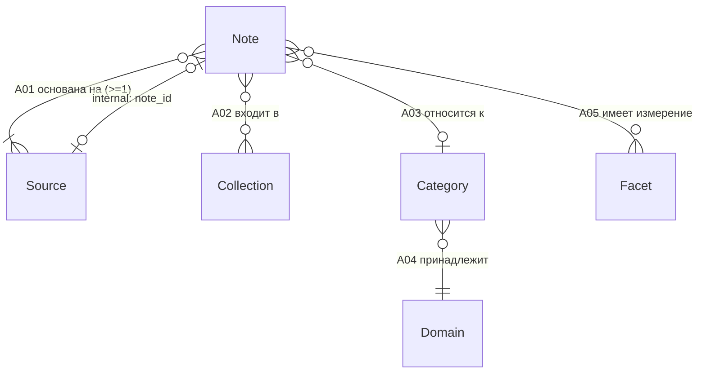

# METAMODEL — метамодель Second Brain PKB

> **v0.1, начальная; подлежит уточнению.**
>
> Версия: `v0.1` · Дата: 2026-10-26 · Итерация: `iter-002` · Основание: [`DL-002`](../decisions/decision-log.md)
> Статус: черновик метамодели. Ни один артефакт не считается устойчивым: состав атрибутов, связи и правила целостности будут уточняться в последующих итерациях (фаза 2 — схема).

## 0. Назначение и границы документа

Метамодель описывает **из чего состоит знание** в Second Brain PKB: сущности, их атрибуты, связи между ними и правила целостности. Это уровень «что существует», а не «как хранится»: типы данных, форматы сериализации, индексы и физическая структура хранилища определяются на фазе 2 (`schema/` — **не создано**).

Границы v0.1:

- сущностей ровно **шесть**, состав зафиксирован `TASK.md` (iter-002) и `DL-002`;
- сущность `Tag` и её производные (метки, ярлыки, ключевые слова как отдельная сущность) в v0.1 **не вводятся** — классификация реализуется сущностями Домен, Категория, Фасет (обоснование — `DL-002`);
- сущности `Attachment`, `Person`, `Task`, `Snippet` и подобные в v0.1 **не вводятся**; потребность в них зафиксирована в разделе «Открытые вопросы»;
- поведение при удалении объектов, версионирование содержимого и права доступа в v0.1 **не определены** (открытые вопросы OQ-01, OQ-06).

## 1. Соглашения

| Соглашение | Значение |
|---|---|
| Язык | Названия сущностей и описания — на русском (`R-001`); идентификаторы сущностей, атрибутов и связей — на английском как будущая основа кода и схемы |
| Идентификатор сущности | `Note`, `Source`, `Collection`, `Domain`, `Category`, `Facet` |
| Идентификатор атрибута | `snake_case`, уникален в пределах сущности |
| Идентификатор связи | `A01`…`A05` (associations) |
| Идентификатор правила целостности | `C-01`…`C-14` (constraints) |
| Обязательность | `обяз.` — значение всегда присутствует; `опц.` — может отсутствовать (`null`) |
| Типы v0.1 | `id`, `text`, `date`, `datetime`, `integer`, `enum`, `ref:<Сущность>`, `m2m:<Сущность>` — логические, уточняются на фазе 2 |
| Группы сущностей | **содержательные** (хранят знание): Заметка, Источник, Коллекция; **классификационные** (описывают, о чём знание): Домен, Категория, Фасет |

## 2. Состав сущностей

| № | Сущность | Идентификатор | Группа | Краткое определение |
|---|---|---|---|---|
| 1 | Заметка | `Note` | содержательная | Атомарная единица знания: одна законченная мысль |
| 2 | Источник | `Source` | содержательная | Внешний или внутренний материал, на котором основана заметка |
| 3 | Коллекция | `Collection` | содержательная | Тематическое объединение заметок (MOC / проект / область) |
| 4 | Домен | `Domain` | классификационная | Верхний уровень классификации, самый широкий |
| 5 | Категория | `Category` | классификационная | Уровень классификации внутри домена |
| 6 | Фасет | `Facet` | классификационная | Ортогональное измерение классификации, вне иерархии Домен→Категория |

## 3. Содержательные сущности

### 3.1 Заметка (`Note`)

Атомарная единица знания. Одна заметка — одна законченная мысль, сформулированная своими словами и привязанная к источнику.

| Атрибут | Тип | Обяз. | Описание |
|---|---|---|---|
| `id` | `id` | обяз. | Уникальный идентификатор заметки (первичный ключ) |
| `title` | `text` | обяз. | Заголовок; непустой, уникальный в пределах базы (правило `C-02`) |
| `body` | `text` | обяз. | Содержательный текст заметки; в v0.1 формат не нормирован (OQ-08) |
| `status` | `enum` | опц. | Состояние проработки: `draft` \| `active` \| `archived`; по умолчанию `draft` |
| `created_at` | `datetime` | обяз. | Дата и время создания |
| `updated_at` | `datetime` | обяз. | Дата и время последнего изменения |

### 3.2 Источник (`Source`)

Материал, на котором основана заметка: внешний (статья, книга, видео, подкаст, документ) или внутренний (другая заметка базы).

| Атрибут | Тип | Обяз. | Описание |
|---|---|---|---|
| `id` | `id` | обяз. | Уникальный идентификатор источника |
| `title` | `text` | обяз. | Название источника; непустой |
| `source_type` | `enum` | обяз. | `web` \| `book` \| `article` \| `video` \| `audio` \| `document` \| `internal` \| `other` |
| `url` | `text` | опц. | Ссылка/адрес; обязателен при `source_type = web` (`C-12`) |
| `citation` | `text` | опц. | Библиографическое описание для офлайн-источников |
| `author` | `text` | опц. | Автор(ы) или организация; в v0.1 строка, не сущность (OQ-10) |
| `published_at` | `date` | опц. | Дата публикации/выхода материала |
| `note_id` | `ref:Note` | опц. | Для `source_type = internal`: указатель на заметку-источник (`C-12`) |
| `created_at` | `datetime` | обяз. | Дата добавления источника в базу |

### 3.3 Коллекция (`Collection`)

Тематическое объединение заметок: карта содержания (MOC), проект, область ответственности, подборка.

| Атрибут | Тип | Обяз. | Описание |
|---|---|---|---|
| `id` | `id` | обяз. | Уникальный идентификатор коллекции |
| `title` | `text` | обяз. | Название; непустое, уникальное в пределах базы (`C-02`) |
| `description` | `text` | опц. | Назначение коллекции и критерии включения заметок |
| `collection_type` | `enum` | опц. | `moc` \| `project` \| `area` \| `resource`; в v0.1 не влияет на поведение |
| `created_at` | `datetime` | обяз. | Дата создания |
| `updated_at` | `datetime` | обяз. | Дата последнего изменения |

> Вложенность коллекций (иерархия «коллекция → подколлекция») в v0.1 **не поддерживается** — см. OQ-02.

## 4. Сущности классификации

### 4.1 Домен (`Domain`)

Верхний, самый широкий уровень классификации. Корень иерархии `Домен → Категория`.

| Атрибут | Тип | Обяз. | Описание |
|---|---|---|---|
| `id` | `id` | обяз. | Уникальный идентификатор домена |
| `title` | `text` | обяз. | Название; непустое, уникальное среди доменов (`C-07`) |
| `description` | `text` | опц. | Границы домена: что в него входит, что — нет |
| `order_index` | `integer` | опц. | Порядок отображения в списке доменов |
| `created_at` | `datetime` | обяз. | Дата создания |

> Поддомены (иерархия внутри домена) в v0.1 **не поддерживаются** — см. OQ-03.

### 4.2 Категория (`Category`)

Уровень классификации внутри домена. Категория принадлежит ровно одному домену.

| Атрибут | Тип | Обяз. | Описание |
|---|---|---|---|
| `id` | `id` | обяз. | Уникальный идентификатор категории |
| `title` | `text` | обяз. | Название; непустое, уникальное в пределах домена-родителя (`C-07`) |
| `domain_id` | `ref:Domain` | обяз. | Домен-родитель; ровно один (`C-05`) |
| `description` | `text` | опц. | Критерии отнесения заметок к категории |
| `order_index` | `integer` | опц. | Порядок отображения в пределах домена |
| `created_at` | `datetime` | обяз. | Дата создания |

### 4.3 Фасет (`Facet`)

Ортогональное измерение классификации, **не входящее** в иерархию `Домен → Категория`. Фасет отвечает на вопрос «какой это материал» (форма, статус проработки, контекст применения, уровень достоверности), тогда как домен и категория отвечают на вопрос «о чём это».

| Атрибут | Тип | Обяз. | Описание |
|---|---|---|---|
| `id` | `id` | обяз. | Уникальный идентификатор фасета |
| `title` | `text` | обяз. | Название; непустое, уникальное среди фасетов (`C-07`) |
| `axis` | `text` | опц. | Метка измерения, к которому относится фасет (например `format`, `maturity`, `context`); группирует фасеты, не образуя иерархии (OQ-05) |
| `description` | `text` | опц. | Смысл измерения и допустимые значения |
| `order_index` | `integer` | опц. | Порядок отображения |
| `created_at` | `datetime` | обяз. | Дата создания |

## 5. Связи между сущностями

| ID | Связь | Направление | Кардинальность | Обязательность | Описание |
|---|---|---|---|---|---|
| `A01` | Заметка ↔ Источник | `Note` → `Source` | 1 : N | у заметки ≥ 1 источника; источник может использоваться ≥ 0 заметками | На каких материалах основана заметка (`C-03`) |
| `A02` | Заметка ↔ Коллекция | `Note` ↔ `Collection` | M : N | необязательна с обеих сторон | Тематические подборки заметок; одна заметка может входить в несколько коллекций |
| `A03` | Заметка → Категория | `Note` → `Category` | N : 1 | у заметки ≤ 1 категории (в v0.1) | Основная классификация заметки (OQ-04) |
| `A04` | Категория → Домен | `Category` → `Domain` | N : 1 | у категории ровно 1 домен | Иерархия классификации; домен заметки выводится через её категорию (`C-05`) |
| `A05` | Заметка ↔ Фасет | `Note` ↔ `Facet` | M : N | необязательна с обеих сторон | Ортогональные измерения; не образуют иерархию и не связаны с доменом/категорией (`C-08`) |

Явно **не установленные** связи v0.1:

| Пара | Статус | Обоснование |
|---|---|---|
| Источник ↔ Коллекция | **не связано в v0.1** | Единственным носителем знания является заметка; коллекция объединяет знания, а не материалы. Прямая связь понадобилась бы только для «коллекции-библиографии» (список литературы без заметок) — вынесено в OQ-04bis и в `DL-002` как сознательный отказ |
| Домен ↔ Фасет | **не связано в v0.1** | Фасет ортогонален иерархии по определению (`C-08`); связь противоречила бы смыслу фасета |
| Категория ↔ Фасет | **не связано в v0.1** | То же: фасет применяется к заметке, а не к узлу классификации |
| Коллекция ↔ Домен/Категория/Фасет | **не связано в v0.1** | Коллекция — содержательная сущность (подборка), её тематика задаётся описанием, а не классификатором; при необходимости выносится в OQ-11 |
| Заметка → Домен (прямая) | **не вводится в v0.1** | Домен заметки определяется транзитивно через категорию (`A03` + `A04`); прямая связь создала бы два источника истины и риск противоречия (`C-06`) |
| Источник ↔ Источник, Заметка ↔ Заметка | **не связано в v0.1** | Связь «заметка → заметка» моделируется опосредованно: внутренним источником (`source_type = internal`, `note_id`). Прямые ссылки между заметками — OQ-11 |

### 5.1 Граф связей (текстовая схема)

```
                        СОДЕРЖАТЕЛЬНЫЕ                      КЛАССИФИКАЦИЯ

                    +----------------+
                    |   Коллекция    |
                    |  (Collection)  |
                    +-------+--------+
                            | A02  M:N (необяз.)
                            |
+------------+   A01 1:N   +v-----------+   A03 N:1    +------------+   A04 N:1   +----------+
|  Источник  |<----------- |   Заметка  | ------------>|  Категория | ----------->|  Домен   |
|  (Source)  |  (>=1 у     |   (Note)   |  (<=1 в v0.1)| (Category) |  (ровно 1)  | (Domain) |
+------------+  заметки)   +------+-----+              +------------+             +----------+
       |                         | A05  M:N (необяз., ортогонально иерархии)
       | note_id                 |
       | (internal)        +-----v------+
       +------------------>|   Фасет    |
        опосредованно      |  (Facet)   |
                           +------------+

   Источник <-> Коллекция: НЕ СВЯЗАНО в v0.1 (см. таблицу выше)
   Фасет -> Домен/Категория: связей нет (C-08)
```

### 5.2 То же в нотации Mermaid (для просмотра на GitHub)



## 6. Правила целостности

| ID | Правило | Проверка |
|---|---|---|
| `C-01` | У заметки **≥ 1 источник** | количество связей `A01` для заметки ≥ 1 |
| `C-02` | Названия непусты и уникальны: `Note.title`, `Collection.title` — уникальны в пределах базы; `Category.title` — в пределах домена-родителя | после `trim` длина > 0; отсутствие дублей в соответствующей области |
| `C-03` | Источник, на который ссылается заметка, существует и не удалён | целостность ссылки `A01` (referential integrity) |
| `C-04` | Связь `A02` (заметка ↔ коллекция) — многие-ко-многим; дубли пары `(note_id, collection_id)` запрещены | уникальность пары в таблице связи |
| `C-05` | Категория принадлежит **ровно одному** домену | `Category.domain_id` заполнен и указывает на существующий домен |
| `C-06` | Домен заметки выводится **единственным путём**: `Заметка → Категория → Домен`; противоречие между прямым и транзитивным значением исключено конструктивно (прямой связи «Заметка → Домен» в v0.1 нет) | отсутствие атрибута/связи прямого назначения домена у заметки |
| `C-07` | Названия сущностей классификации непусты и уникальны в пределах родителя: `Domain.title` — среди доменов, `Category.title` — внутри домена, `Facet.title` — среди фасетов | после `trim` длина > 0; отсутствие дублей |
| `C-08` | Фасет **не участвует** в иерархии `Домен → Категория`: у фасета нет родителя среди доменов и категорий, у домена и категории нет ссылок на фасет как на узел иерархии | отсутствие связей `Facet → Domain`, `Facet → Category` |
| `C-09` | Множества сущностей классификации не пересекаются: объект не может одновременно быть доменом, категорией и фасетом | раздельные наборы сущностей, наследование иерархии запрещено |
| `C-10` | `id` уникален в пределах своей сущности и неизменяем после создания | первичный ключ |
| `C-11` | `created_at` ≤ `updated_at` для `Note` и `Collection` | сравнение дат |
| `C-12` | Тип источника согласован: `source_type = web` ⇒ заполнен `url`; `source_type = internal` ⇒ заполнен `note_id` и указывает на существующую заметку, отличную от самой заметки-владельца источника | условная обязательность + запрет самоцикла |
| `C-13` | Любая ссылка указывает на существующий объект; поведение при удалении объекта в v0.1 **не определено** (каскад/запрет/пометка удаления) | referential integrity; см. OQ-01 |
| `C-14` | Классификация выполняется только сущностями `Domain`, `Category`, `Facet`; сущность `Tag` и её производные в модели отсутствуют | проверка состава сущностей метамодели |

## 7. Сводная матрица обязательности

| Сущность | Обязательные атрибуты | Обязательные связи |
|---|---|---|
| `Note` | `id`, `title`, `body`, `created_at`, `updated_at` | ≥ 1 `Source` (`A01`, `C-01`) |
| `Source` | `id`, `title`, `source_type`, `created_at`; условно `url` / `note_id` (`C-12`) | — |
| `Collection` | `id`, `title`, `created_at`, `updated_at` | — |
| `Domain` | `id`, `title`, `created_at` | — |
| `Category` | `id`, `title`, `domain_id`, `created_at` | ровно 1 `Domain` (`A04`, `C-05`) |
| `Facet` | `id`, `title`, `created_at` | — |

## 8. Открытые вопросы

Нерешённые неоднозначности v0.1. Новые сущности в модель **не вводились** — все потребности перечислены ниже как вопросы к последующим итерациям.

| ID | Вопрос | Почему важно | Кому решать |
|---|---|---|---|
| OQ-01 | Поведение при удалении: что происходит с заметкой, у которой после удаления источника остаётся 0 источников (`C-01` нарушается)? Каскадное удаление, запрет удаления или «мягкое» удаление? | Без этого правила `schema/` и `plugin/` не могут реализовать удаление корректно | Оркестратор → DL |
| OQ-02 | Нужна ли иерархия коллекций (`Collection → Collection`)? | MOC верхнего уровня обычно ссылается на вложенные MOC | Оркестратор → DL |
| OQ-03 | Нужны ли поддомены (`Domain → Domain`)? | Сейчас иерархия жёстко двухуровневая: домен → категория | Оркестратор → DL |
| OQ-04 | Достаточно ли одной категории у заметки (N:1)? Нужна ли множественная классификация (N:M)? | Ограничение v0.1 может не покрыть междисциплинарные заметки | Оркестратор → DL |
| OQ-04bis | Нужна ли связь `Источник ↔ Коллекция` для «коллекций-библиографий» (список литературы без заметок)? | В v0.1 связь сознательно не установлена | Оркестратор → DL |
| OQ-05 | `Facet.axis` — строка или самостоятельная сущность «измерение»? | Строка не даёт валидации и переиспользования; сущность нарушила бы лимит шести | Оркестратор → DL |
| OQ-06 | Нужно ли версионирование содержимого заметки (история правок) вместо одного `updated_at`? | Second Brain подразумевает ревизии знания | Оркестратор → DL |
| OQ-07 | Формат и правила генерации `id`: UUID, slug, числовой ключ? | Определяет структуру хранилища и ссылки между файлами | фаза 2 (`schema/`) |
| OQ-08 | Формат `Note.body`: Markdown, plain text, разметка с ссылками на сущности? | Влияет на плагин и на способ представления связей | фаза 2/3 |
| OQ-09 | Нужны ли служебные атрибуты: владелец, метка последней ревизии, флаг «избранное», порядок в коллекции? | Расширяет атрибутный состав без новых сущностей | Оркестратор |
| OQ-10 | `Source.author` — строка или будущая сущность `Person`? | В v0.1 строка; сущность `Person` не вводилась намеренно | Оркестратор → DL |
| OQ-11 | Нужны ли прямые связи `Заметка ↔ Заметка` (двунаправленные ссылки, backlinks) вместо опосредования внутренним источником? | Ключевая механика PKB — ссылки между заметками; сейчас моделируется через `source_type = internal` | Оркестратор → DL |
| OQ-12 | Потребность в сущностях, не вошедших в v0.1: `Attachment` (вложения), `Task` (действия), `Snippet` (цитаты) | Зафиксировано как потребность, в модель не вводилось | Оркестратор → DL |
| OQ-13 | Точные пути компонентов: TASK.md (iter-002) закрепил `docs/metamodel/`, пути `schema/` и `plugin/` по-прежнему не утверждены | Без этого фаза 2 может создать файлы не там, где ждёт Оркестратор | Оркестратор → DL |
| OQ-14 | Допустимые значения `enum` (`status`, `source_type`, `collection_type`) — закрытые списки или расширяемые? | Влияет на валидацию в схеме | фаза 2 (`schema/`) |

## 9. Соответствие артефактам рабочего процесса

- Состав сущностей и требование «ровно шесть» — [`docs/_workflow/TASK.md`](../_workflow/TASK.md) (iter-002, раздел «Состав метамодели v0.1»).
- Обоснование отказа от `Tag` и от прямой связи `Источник ↔ Коллекция` — [`DL-002`](../decisions/decision-log.md).
- Язык артефактов и идентификаторов — `R-001` в [`docs/_workflow/RULES.md`](../_workflow/RULES.md).
- Текущая фаза и статус компонента — [`docs/project-map/PROJECT_MAP.md`](../project-map/PROJECT_MAP.md), [`docs/CHECKPOINT.md`](../CHECKPOINT.md).
- Следующий шаг (фаза 2, `schema/`) — [`DL-002`](../decisions/decision-log.md), раздел «Последствия».
